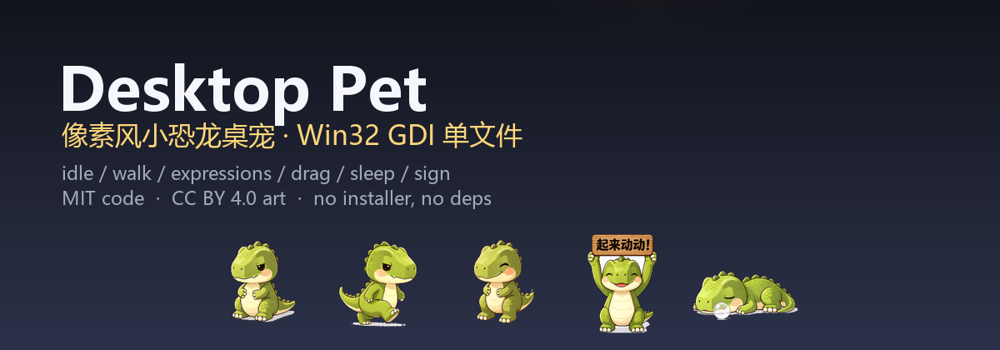
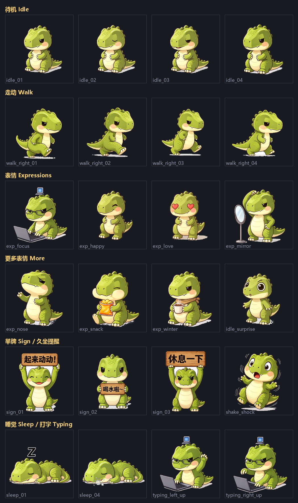

<div align="center">



# Desktop Pet · a pixel dino that lives on your desktop

**A 2.3 MB single-file Windows desktop pet — statically linked, zero dependencies, runs anywhere.**

[中文](README.md) · [Download](https://github.com/waspqj/desktop-pet/releases) · [Source](https://github.com/waspqj/desktop-pet) · [License](#license)

</div>

---

## What it does

| Behaviour | How it triggers |
|---|---|
| **Idle** | Default state: 4-frame breathing loop with random blinks |
| **Wandering** | Strolls around on its own from time to time, in all four directions |
| **Expressions** | Click the dino → it switches to a random expression set (focus / happy / love / mirror / sniff / snack / winter) |
| **Being dragged** | Grabbing a different body part gives a different reaction: head → dizzy, tail → squirm, body → wobble |
| **Keeps you company while you type** | Detects your keystrokes and lies down to type along (55-key whitelist, no full-keyboard scan) |
| **Sitting too long?** | After 45 min of no input (configurable: 30/45/60), it walks to the centre of the screen and holds up a sign: "Time to move!" / "Take a break" / "Drink water" |
| **Hourly stroll** | On the hour, it walks across the whole screen |
| **Goes to bed** | Left alone for 5 minutes, it walks to the corner and sleeps with floating Z's |
| **Tray menu** | Right-click the tray icon: auto-start, reminder interval, test any action, quit |

<p align="center">
  
</p>

---

## Quick start

1. Grab `pet.exe` (≈2.3 MB) from the [Releases](https://github.com/waspqj/desktop-pet/releases) page.
2. Double-click it. The dino walks up from the bottom of the screen. That's it.

**That's the whole install.** No installer, no runtime, no config, no background services.

> ⚠️ **Windows may show "Windows protected your PC" on first launch** (SmartScreen, because the binary is unsigned).
> Click "More info" → "Run anyway". To avoid it entirely, build it yourself — see below.

### Want it on startup / in a fixed location?

```bat
install.cmd
```

Installs `pet.exe` to `%LOCALAPPDATA%\DesktopPet\` and offers to register auto-start
(writes `HKCU\...\Run` — user scope only, no system-wide changes).

To remove it:

```bat
uninstall.cmd
```

Kills the process, removes the auto-start entry, the install folder and `pos.ini`. Nothing left behind.

---

## How light is it?

| Metric | Measured |
|---|---|
| Single file size | 2.23 MB (static, no external deps) |
| Resident memory (Private) | **4.72 MB** |
| GDI objects | 30 |
| Render time per frame | **8.9 µs** (83.2 µs in the first version) |
| CPU while being dragged | 2.16 % of one core |
| Startup warm-up | Preloads 16 frames, the rest on demand with LRU |

Technically it's a classic **Win32 GDI layered window**:
`WS_EX_LAYERED | WS_EX_TOPMOST | WS_EX_TOOLWINDOW | WS_EX_NOACTIVATE`, and every frame is pushed to the
screen with `UpdateLayeredWindow(..., ULW_ALPHA)` using premultiplied-alpha BGRA bitmaps — no windows,
no controls, never covers your other programs.

A few details that keep it out of your way:

- Clicking it **never steals focus** from the window you're typing in (`WM_MOUSEACTIVATE` + `WS_EX_NOACTIVATE`)
- It doesn't inject an IME into your input boxes (`ImmAssociateContext`)
- Only one instance, ever (single-instance mutex)
- The tray icon comes back by itself after Explorer restarts (handles `TaskbarCreated`)

---

## Build it yourself

Requires **MinGW-w64** (with `gcc` and `windres`): [mingw-w64.org/downloads](https://www.mingw-w64.org/downloads/)

```bat
build.bat
```

Output lands in `build\pet.exe`. The script looks for `D:\mingw64\bin` first, then falls back to `gcc`/`windres` on `PATH`.

For CI or other toolchains, the raw commands are:

```bat
windres -i pet.rc -o build\pet_res.o
gcc pet.c build\pet_res.o -o build\pet.exe -mwindows -static -s -Os ^
    -finput-charset=utf-8 -lgdi32 -luser32 -lole32 -lshell32 -ladvapi32 -limm32
```

---

## Swap in your own skin

**You don't have to touch a single line of C.**

1. Drop 47 transparent-background PNGs into `assets/frames/`, keeping the file names
   (`idle_01.png`, `walk_right_01.png`, `sign_01.png`, … — full list in `pet.rc`).
2. Convert them into the runtime frame format:

   ```powershell
   powershell -NoProfile -ExecutionPolicy Bypass -File make_frames.ps1
   ```

3. Rebuild with `build.bat`.

Frame format: 110×110, **premultiplied-alpha** BGRA, with an 8-byte `[u32 W][u32 H]` header.
`make_frames.ps1` handles resizing and premultiplication; clean up your cut-out edges first.

> The three reminder signs ship with Chinese text. To localise them, replace
> `assets/frames/sign_01..03.png` and re-run the conversion.

---

## FAQ

**Q: Nothing happens when I double-click / my AV keeps deleting it?**
A: Unsigned fresh binaries are commonly false-flagged. Check the hash against `SHA256SUMS.txt`;
if it matches, it's a false positive — allow-list it. Or build it yourself.

**Q: SmartScreen keeps nagging?**
A: "More info" → "Run anyway", and tick "don't show again". The only real fixes are building
it yourself or getting a code-signing certificate.

**Q: The pet ignores my keyboard and can't be dragged, but it still walks and sleeps?**
A: Almost certainly the exe's **integrity level got set to Low**. Low-integrity processes always
get `0` from `GetAsyncKeyState`, so every keyboard-dependent feature dies while everything else
keeps working. Fix:

  ```bat
  icacls "pet.exe" /setintegritylevel Medium
  ```

  This is also why you should **avoid tools that rewrite security attributes** when moving the exe around
  (some archivers and sync clients do it silently).

**Q: How do I make it start with Windows?**
A: Tray icon → enable auto-start; or run `install.cmd` once.

**Q: How often does it nag me to move?**
A: 30 / 45 / 60 minutes from the tray menu (45 by default).

**Q: How do I make it go away / come back?**
A: Just drag it. There are also debug switches: `--test-walk`, `--test-sign-now`, `--test-sleep-now`,
`--test-remind`, `--remind-set=N`.

**Q: macOS / Linux?**
A: Not yet — this is a pure Win32 GDI implementation and runs on **64-bit Windows only**.
A port is conceivable, but not today.

**Q: Does it phone home?**
A: No. The program contains no sockets and no networking code at all. Its entire state lives in
`%APPDATA%\PetDinoPet\pos.ini`.

---

## Repository layout

```
desktop-pet/
├── pet.c                  # all the logic, single file
├── pet.rc                 # resource table (frame ID ↔ file name)
├── build.bat              # build script
├── install.cmd            # install + optional auto-start
├── uninstall.cmd          # full removal
├── make_frames.ps1        # PNG → .dat frame conversion (for re-skins)
├── assets/
│   ├── frames/            # 47 source artworks (512×512 downscaled copies)
│   ├── frames_raw/        # 47 runtime .dat frames (110×110 premultiplied BGRA)
│   └── dino_icon.ico      # app / tray icon
├── docs/                  # preview sheet + banner
├── LICENSE                # MIT (code)
└── ASSETS.md              # artwork license (CC BY 4.0 + AI-generation notice)
```

---

## License

- **Code:** [MIT](LICENSE) — use it, change it, sell it.
- **Artwork:** [CC BY 4.0](ASSETS.md) — commercial use and derivatives allowed with attribution.
  These images were **AI-generated with Doubao (豆包)**, not hand-drawn; the provenance is documented in `ASSETS.md`.

---

## Credits

- Artwork: text-to-image with [Doubao (豆包)](https://www.doubao.com)
- Framework: Win32 GDI / `UpdateLayeredWindow` — no third-party graphics library involved

<p align="center">
  <sub>If this is useful to you, a ⭐ Star would keep me going.</sub>
</p>
