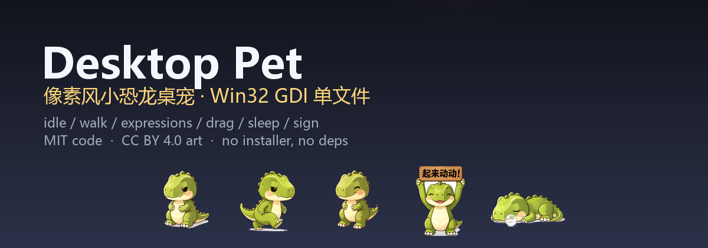
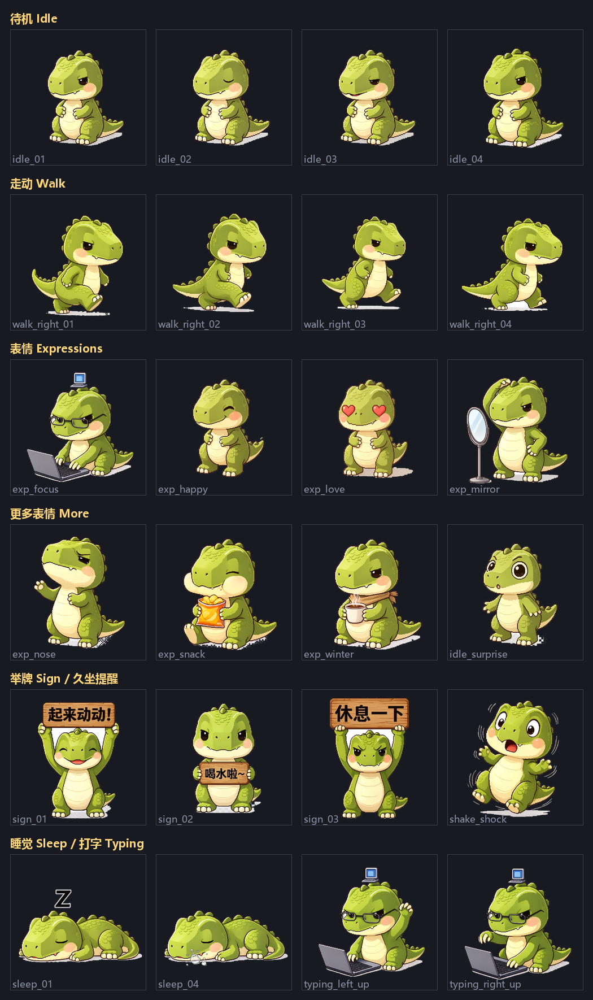

<div align="center">



# Desktop Pet · 像素风小恐龙桌宠

**一个 2.3 MB 的单文件 Windows 桌面宠物 —— 静态链接、零依赖、拖到哪都能跑。**

[English](README.en.md) · [下载](https://github.com/waspqj/desktop-pet/releases) · [源码](https://github.com/waspqj/desktop-pet) · [许可](#许可)

</div>

---

## 它会做什么

| 行为 | 触发方式 |
|---|---|
| **待机** | 默认状态，4 帧呼吸循环 + 随机眨眼 |
| **散步** | 每隔一会儿自己溜达一段路，会上下左右走 |
| **换表情** | 单击恐龙 → 随机换一套表情池（专注 / 开心 / 爱你 / 照镜子 / 嗅 / 零食 / 冬天） |
| **被拖拽** | 按住不同部位有不同反应：抓头会晕、抓尾巴会挣扎、拖身体会晃 |
| **陪你敲键盘** | 检测到你在打字，它就趴下来敲键盘（白名单 55 键检测，不扫全键盘） |
| **久坐提醒** | 连续坐满 45 分钟（可调 30/45/60），它会走到屏幕中央举牌：「起来动动!」「休息一下」「喝水啦~」 |
| **整点遛弯** | 每到整点，它会横着屏幕走一圈 |
| **回窝睡觉** | 静置 5 分钟无人理它，走回屏幕角落睡觉，冒 Z |
| **托盘菜单** | 右键托盘图标：开机自启、久坐提醒间隔、立即测试各动作、退出 |

<p align="center">
  
</p>

---

## 快速开始

1. 到 [Releases](https://github.com/waspqj/desktop-pet/releases) 下载 `pet.exe`（约 2.3 MB）。
2. 双击运行。恐龙会从屏幕底部走上来 —— 完事。

**就这一步。** 没有安装器、没有运行库、没有配置、没有后台服务。

> ⚠️ **Windows 第一次运行会弹「已保护你的电脑」**（SmartScreen，因为没有代码签名）。
> 点「更多信息」→「仍要运行」即可。想彻底避免就自己编译一份，或看下面的 [常见问题](#常见问题)。

### 想要开机自启 / 装到固定位置？

```bat
install.cmd
```

会把 `pet.exe` 装到 `%LOCALAPPDATA%\DesktopPet\`，并询问是否加入开机自启（写 `HKCU\...\Run`，不碰系统级设置）。

卸载：

```bat
uninstall.cmd
```

停进程、删自启项、删安装目录和 `pos.ini`，一条不留。

---

## 它有多轻

| 指标 | 实测 |
|---|---|
| 单文件体积 | 2.23 MB（静态链接，无外部依赖） |
| 常驻内存 (Private) | **4.72 MB** |
| GDI 对象 | 30 |
| 单帧渲染耗时 | **8.9 µs**（早期版本 83.2 µs） |
| 拖动时 CPU | 单核 2.16% |
| 启动预热 | 只预加载 16 张帧，其余按需加载 + LRU |

技术上是经典的 **Win32 GDI 分层窗口**：`WS_EX_LAYERED | WS_EX_TOPMOST | WS_EX_TOOLWINDOW | WS_EX_NOACTIVATE`，
每帧用 `UpdateLayeredWindow(..., ULW_ALPHA)` 直接把预乘 alpha 的 BGRA 位图贴到屏幕上 —— 没有窗口、没有控件、没有遮挡其他程序。

几个让它「不惹人烦」的细节：

- 点它**不会**抢走你正在输入的窗口焦点（`WM_MOUSEACTIVATE` + `WS_EX_NOACTIVATE`）
- 不会往你的输入框里注入输入法（`ImmAssociateContext`）
- 双击两次只会有一只（单实例互斥量）
- 资源管理器重启后托盘图标会自动回来（处理 `TaskbarCreated`）

---

## 自己编译

需要 **MinGW-w64**（带 `gcc` 和 `windres`）：[mingw-w64.org/downloads](https://www.mingw-w64.org/downloads/)

```bat
build.bat
```

产物在 `build\pet.exe`。脚本会自动找 `D:\mingw64\bin`，找不到就在 `PATH` 里找 `gcc` / `windres`。

编译命令（供 CI / 其他工具链参考）：

```bat
windres -i pet.rc -o build\pet_res.o
gcc pet.c build\pet_res.o -o build\pet.exe -mwindows -static -s -Os ^
    -finput-charset=utf-8 -lgdi32 -luser32 -lole32 -lshell32 -ladvapi32 -limm32
```

---

## 换成你自己的皮

**不用改一行 C 代码。**

1. 准备 47 张透明背景 PNG，丢进 `assets/frames/`，文件名保持一致
   （`idle_01.png`、`walk_right_01.png`、`sign_01.png` …，完整清单见 `pet.rc`）。
2. 转换成运行时帧格式：

   ```powershell
   powershell -NoProfile -ExecutionPolicy Bypass -File make_frames.ps1
   ```

3. `build.bat` 重新编译。

帧文件格式：110×110、**预乘 alpha** 的 BGRA，前 8 字节是 `[u32 W][u32 H]`。
`make_frames.ps1` 会自动缩放并做预乘，抠图边缘建议先处理干净。

> 举牌的三张牌子上有中文（起来动动 / 休息一下 / 喝水啦~）。想换成英文或别的语言，
> 替换 `assets/frames/sign_01..03.png` 再跑一次转换就行。

---

## 常见问题

**Q：双击没反应 / 被杀软拦了？**
A：新发布的未签名程序常被杀软误报。检查 `SHA256SUMS.txt` 里的校验值是否一致；
一致的话就是误报，加白名单即可。也可以直接自己编译一份。

**Q：SmartScreen 一直弹？**
A：点「更多信息」→「仍要运行」，勾上就不再弹。真正想免掉只有两条路：自己编译，或买代码签名证书。

**Q：宠物不响应键盘 / 拖不动，但走路、睡觉都正常？**
A：八成是 **exe 的完整性级别被设成了 Low**。Low 完整性进程里 `GetAsyncKeyState` 恒返回 0，
所以键盘相关功能全废，其它功能照常。修复：

  ```bat
  icacls "pet.exe" /setintegritylevel Medium
  ```

  这也是为什么**别用会改安全属性的方式传递 exe**（某些压缩/网盘同步会顺手改它）。

**Q：怎么让它开机就出现？**
A：托盘图标右键 → 开启开机自启；或跑一次 `install.cmd`。

**Q：多久提醒我起来活动？**
A：托盘菜单里选 30 / 45 / 60 分钟（默认 45）。

**Q：怎么让它走开 / 叫它过来？**
A：直接拖它。命令行还有调试开关：`--test-walk`、`--test-sign-now`、`--test-sleep-now`、`--test-remind`、`--remind-set=N`。

**Q：支持 macOS / Linux 吗？**
A：目前是纯 Win32 GDI 实现，**只支持 64 位 Windows**。移植方向是有的，但不是现在。

**Q：它会联网吗？**
A：不会。整个程序没有 socket、没有网络代码，所有状态都写在 `%APPDATA%\PetDinoPet\pos.ini` 里。

---

## 目录结构

```
desktop-pet/
├── pet.c                  # 全部逻辑，单文件
├── pet.rc                 # 资源表（帧 ID ↔ 文件名）
├── build.bat              # 编译脚本
├── install.cmd            # 安装 + 可选开机自启
├── uninstall.cmd          # 完整卸载
├── make_frames.ps1        # PNG → .dat 帧转换（换皮用）
├── assets/
│   ├── frames/            # 47 张美术原图（512×512 压缩副本）
│   ├── frames_raw/        # 47 个 .dat 运行时帧（110×110 预乘 BGRA）
│   └── dino_icon.ico      # 应用 / 托盘图标
├── docs/                  # 预览图与横幅
├── LICENSE                # 代码 MIT
└── ASSETS.md              # 美术授权（CC BY 4.0 + AI 生成声明）
```

---

## 许可

- **代码**：[MIT](LICENSE) —— 随便改、随便用、随便卖。
- **美术**：[CC BY 4.0](ASSETS.md) —— 可商用可改编，需署名。
  这批图由 **AI 生成工具「豆包」** 生成，非人工手绘，已在 `ASSETS.md` 里写明来源。

---

## 致谢

- 美术：[豆包（Doubao）](https://www.doubao.com) 文生图
- 框架：Win32 GDI / `UpdateLayeredWindow`，没依赖任何第三方图形库

<p align="center">
  <sub>如果这个项目对你有点用，点个 ⭐ Star 会让我更有动力继续做下去。</sub>
</p>
